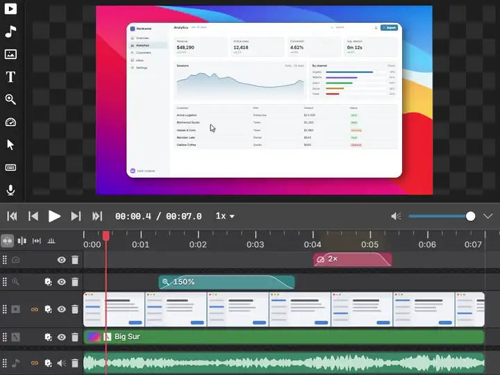
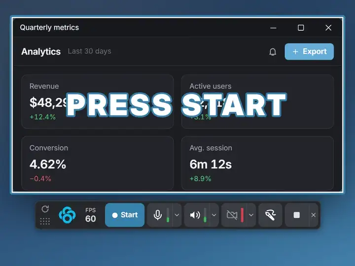
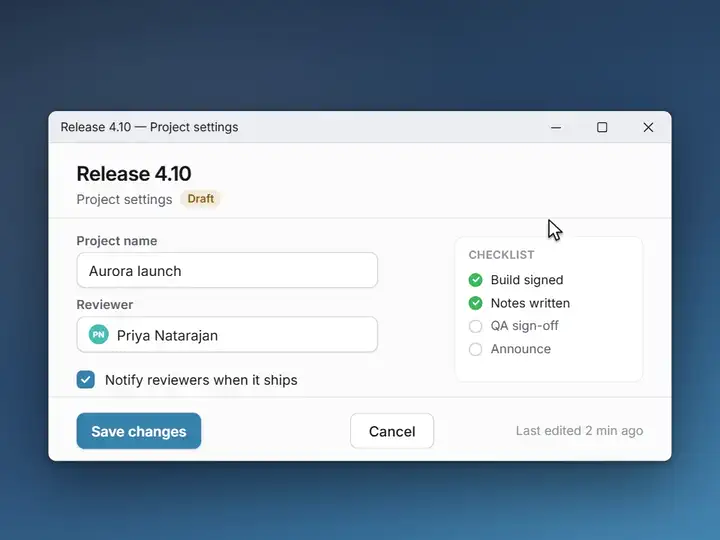
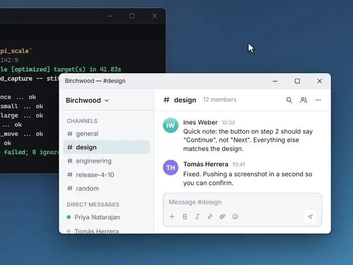
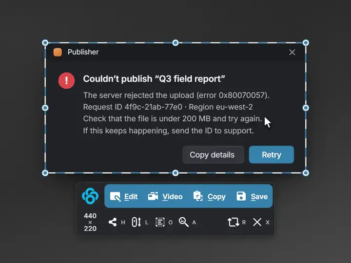
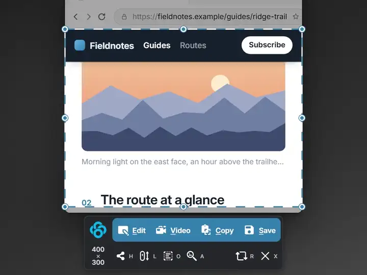
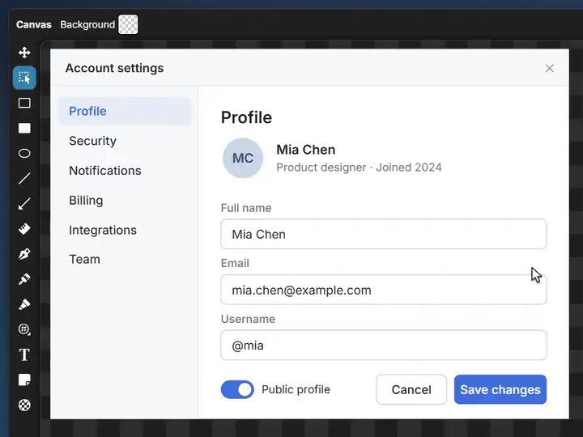
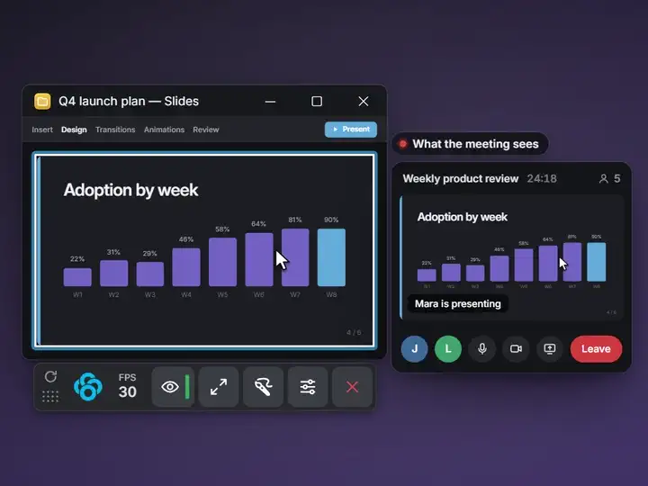
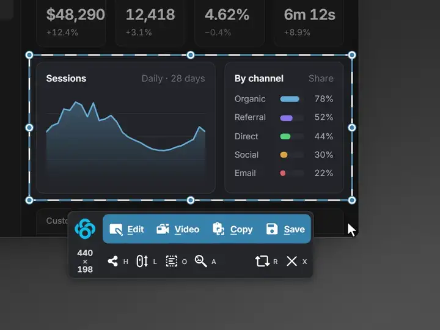

  

  
  
  
  

<h3 align="center">Capture, annotate, record and edit anything, all in one app.</h3>

  Pixel-perfect screenshots, scrolling capture, on-device OCR, draw on screen, screen recording and a real multi-track video editor. 
  It lives in your tray, wakes up when you press <kbd>PrtScn</kbd>, and gets out of your way the moment you're done. 
  <b>Free and open source. No account, no trial, no watermark.</b>

https://github.com/user-attachments/assets/9aa1b37f-cd94-4b0a-ac25-0c002d3c4f4a

---

## Everything in one tray icon

Capture it, annotate it, record it, edit it, share it. Every feature is a switch, so you can turn off whatever you don't use and it disappears.

- [Video editor](#video-editor): from raw recording to share-ready
- [Screen recording](#screen-recording): record once, polish it later
- [Draw on screen](#draw-on-screen): draw on anything, then get back to work
- [Screenshots](#screenshots): snap a window or crop to the pixel
- [OCR](#ocr): copy text from anything on screen
- [Scrolling capture](#scrolling-capture): the whole page in one image
- [Image editor](#image-editor): arrows, steps and blur, one key each
- [Share region](#share-region): share just part of your screen in any meeting
- [Upload & share](#upload--share): instant links to your own storage

---

## Download

**Every feature is in the free download. No trial, no watermark.** Installed builds keep themselves up to date, and only update after you've been idle for a while, never mid-capture. Experimental builds can be opted into in Settings.

| Platform | Installer | Portable |
| --- | --- | --- |
| Windows x64 | [Clowd-win-x64-Setup.exe](https://github.com/clowd/Clowd/releases/latest/download/Clowd-win-x64-Setup.exe) | [Clowd-win-x64-Portable.zip](https://github.com/clowd/Clowd/releases/latest/download/Clowd-win-x64-Portable.zip) |
| Windows arm64 | [Clowd-win-arm64-Setup.exe](https://github.com/clowd/Clowd/releases/latest/download/Clowd-win-arm64-Setup.exe) | [Clowd-win-arm64-Portable.zip](https://github.com/clowd/Clowd/releases/latest/download/Clowd-win-arm64-Portable.zip) |
| macOS Apple Silicon | [Clowd-osx-arm64-Setup.pkg](https://github.com/clowd/Clowd/releases/latest/download/Clowd-osx-arm64-Setup.pkg) | [Clowd-osx-arm64-Portable.zip](https://github.com/clowd/Clowd/releases/latest/download/Clowd-osx-arm64-Portable.zip) |
| macOS Intel | [Clowd-osx-x64-Setup.pkg](https://github.com/clowd/Clowd/releases/latest/download/Clowd-osx-x64-Setup.pkg) | [Clowd-osx-x64-Portable.zip](https://github.com/clowd/Clowd/releases/latest/download/Clowd-osx-x64-Portable.zip) |

Requires Windows 10+ or macOS 13+.

---

## Video editor

**A real timeline, not a trimmer.** Zoom in where attention should land, skip the waiting, restyle the cursor and drop it on a polished background. From raw recording to share-ready.

- **Zoom and speed.** Zoom in where it matters, and skip the boring parts at up to 10×.
- **Restyle it after you record.** Cursor packs, click effects and live keystroke overlays, all changeable later.
- **Backgrounds in one click.** Rounded corners, shadow and a backdrop that makes any recording look finished.
- **On-device AI.** The Speech Enhancer cleans up your voice and background removal cuts out your webcam, on your own GPU.
- **What you see is what you get.** The preview and the export match frame for frame, and it saves as you go.

AI effects need Windows or a Mac with Apple Silicon.

**[Learn more about the video editor →](https://clowd.studio/features/video-editor)**

---

## Screen recording

**Record once, decide later.** Screen, webcam, microphone and system audio each land on their own track, so nothing is baked in until you say so.

- **Separate tracks.** Screen, webcam, mic and system audio, each on its own row in the editor.
- **Cursor you can restyle.** The cursor, clicks and keystrokes are recorded as data, so you can change them after you stop.
- **Up to 240 fps.** Smooth enough for fast-moving demos, with a live frame counter as you record.
- **Crash-safe.** Hardware encoding when your GPU has it, and a power cut doesn't cost you the recording.

**[Learn more about screen recording →](https://clowd.studio/features/screen-recording)**

---

## Draw on screen

**Draw on anything, then click straight through to your apps.** Walkthroughs, onboarding and code reviews that feel like you're sitting next to them.

- **Draw, then <kbd>Esc</kbd>.** Your ink stays on screen while you click, scroll and type underneath it.
- **Live keystrokes.** Every shortcut you press shows up on screen, so nobody has to ask what you just did.
- **Every tool is one key.** You never break stride mid-sentence.
- **Freeze the frame or keep it live.** Draw on a still, or right over a playing video.
- **One undo for every screen.** Undo works across all your monitors, in the order you drew.

**[Learn more about Draw on Screen →](https://clowd.studio/features/draw-on-screen)**

---

## Screenshots

**Press <kbd>PrtScn</kbd>. It's already there.** Snap to a whole window in one click, or zoom in and crop to the exact pixel. Then take it anywhere in Clowd with a single key.

- **Opens instantly.** The screen is frozen and ready the moment you press the key.
- **Click a window, get the window.** Even one that's partly hidden behind another, with its rounded corners kept transparent.
- **Zoom to the pixel.** Scroll to zoom in up to 256× and place the edge exactly where you want it.
- **Keyboard first.** Every button is one letter. <kbd>Enter</kbd> edits, <kbd>Esc</kbd> backs out.
- **Built-in color picker.** Press <kbd>H</kbd> on any pixel for its HEX, RGB or HSL.
- **Owns <kbd>PrtScn</kbd>,** even on Windows 11.

**[Learn more about the capture overlay →](https://clowd.studio/features/capture)**

---

## OCR

**Copy text from anything on screen.** Screenshots, videos, error dialogs: anywhere you can't normally select text.

- **Private.** Text is read on your computer. No cloud, no API key, no language pack to install.
- **Check it first.** Every line lifts off the screenshot, so you see what it read before you use it.
- **One key out.** Copy it, search the web for it or share it as a paste in a single keypress.
- **Reads the hard stuff.** Small type, dark mode and low contrast.

Requires Windows or a Mac with Apple Silicon. Latin, Greek, Chinese and Japanese kana; Cyrillic and Korean aren't supported yet.

**[Learn more about OCR →](https://clowd.studio/features/ocr)**

---

## Scrolling capture

**The whole page, not just the part that fits.** A long article, a chat history, a settings page: Clowd scrolls it for you and stitches it into one tall image.

- **Sticky headers appear once,** not repeated down the length of the image.
- **Starts from the top.** It winds the page back first, so it doesn't matter where you were scrolled to.
- **Stops on its own** when it reaches the end of the document.
- **Take your mouse back whenever you like.** Moving the cursor pauses the capture; let go and it picks up where it left off.

Scrolls whole windows, not panes inside them. Needs Accessibility permission on macOS.

**[Learn more about scrolling capture →](https://clowd.studio/features/scrolling-capture)**

---

## Image editor

**Mark it up. Send it. Move on.** Curved arrows, numbered steps that point, and redaction that never blurs your notes. One key per tool.

- **15 tools, one key each.** <kbd>R</kbd> for a rectangle, <kbd>A</kbd> for an arrow, <kbd>O</kbd> to hide a password.
- **Objects stay editable.** Move, restyle or delete anything you drew, at any point.
- **Sessions autosave.** Restart your PC and your open editors come back, annotations intact.
- **Pin it on top** so a capture stays visible while you work.

**[Learn more about the image editor →](https://clowd.studio/features/image-editor)**

---

## Share region

**Share any rectangle, in any meeting app.** Meeting apps share a whole screen or one window. Clowd lets you share exactly the part that matters, in Teams, Zoom, Meet or anything else.

- **A panic button.** Blur or black out the share without stopping it.
- **Move it mid-meeting.** Reframe the region and nobody has to re-share.
- **Every control outside the frame,** so the meeting never sees them.
- **Point at things.** Draw on screen and the meeting sees it.

**[Learn more about Share Region →](https://clowd.studio/features/share-region)**

---

## Upload & share

**Your storage, your rules.** Share a screenshot, a recording or a whole folder, and the link is on your clipboard before the upload has finished.

- **Instant links.** With accelerated uploads, the link is copied the moment the upload *starts*, and recipients can start watching while you're still uploading.
- **Your bucket, your keys.** Amazon S3 (and S3-compatible), Azure Blob Storage, Cloudflare R2 and Backblaze B2.
- **Nothing kept on the way.** Accelerated uploads only pass through. Or switch them off and upload direct.
- **Off until you want it.** One switch turns uploads off and every upload button disappears.

**[Learn more about Upload & Share →](https://clowd.studio/features/upload-share)**
